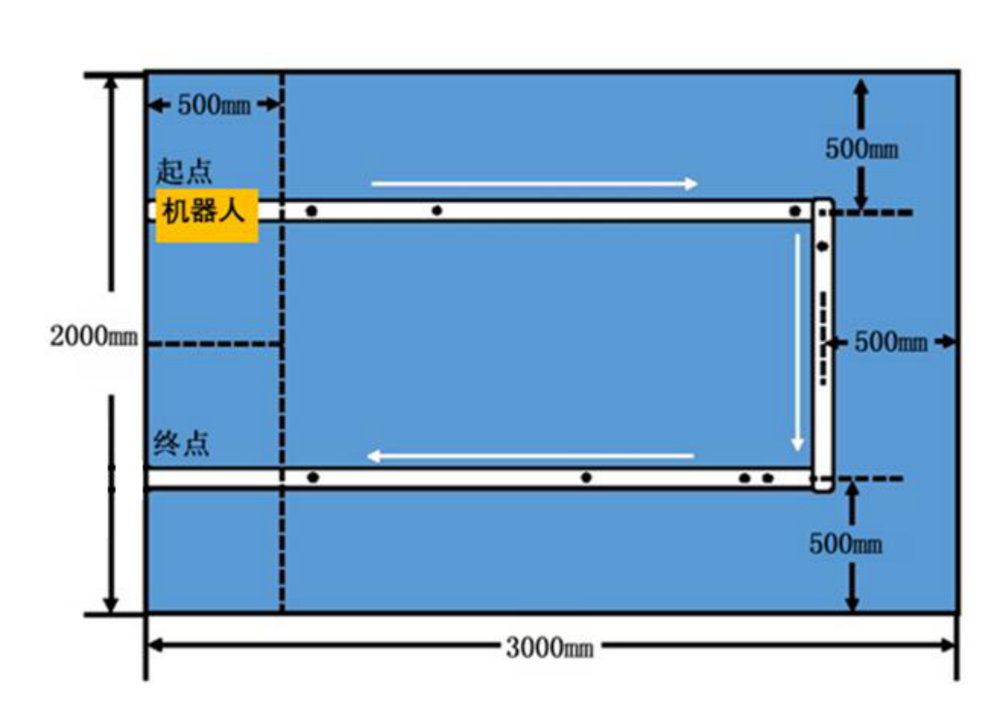

# 赛题事实（场地、道具、流程、判罚、评分）

> 入口索引与工作约定在仓库根目录 [`AGENTS.md`](../../AGENTS.md)；本文件是 `.dsh/agents/` 知识库的一部分，**是场地与评分数字的唯一权威来源**——其它文档和代码只能引用这里，不许各自抄一份。

**本文件状态：全文 `【事实】`**，出处为赛题原文 [`docs/16水中机器人巡检任务挑战赛(6)(1).pdf`](../../docs/16水中机器人巡检任务挑战赛%286%29%281%29.pdf)（下称「原文」，括号内标页码）。原文没写的、或与图矛盾的地方，单独标 `【待验证】`，不许当事实用。

## 赛事与阶段

- 【事实】赛事名称：全球校园人工智能算法精英大赛 · 算法应用赛 · 水中机器人巡检任务挑战赛（p1）
- 【事实】比赛分三阶段：校赛（各院校参照本规则自行组织并推荐）→ 省赛（区域赛）→ 全国总决赛（p1）
- 【事实】报名结束后才确定比赛形式，以组委会文件通知为准；赛前发布赛制说明（p1）
- 【事实】线下与线上赛规则并行，线上赛沿用线下的场地、规格、传感器与通信限制（p4）
- 【事实】两种形式都是 **2 轮，取最高分**；平分时用时短者靠前（p2、p5）

## 场地

| 项目 | 规定 | 出处 |
| --- | --- | --- |
| 水池尺寸 | 3000mm（长）× 2000mm（宽）× 600mm（高） | p3 |
| 水面高度 | 260mm ± 20mm | p3 |
| 池底 / 池壁 | 湖蓝色防水涂层，模拟真实水下环境 | p3 |
| 路径 | 池底 LED 灯带，含直道与 90° 弯角，**路径总长约 6m**（实物为白色圆柱管道，见下方「实物补充」） | p3 |
| 起点区 | 距池壁约 500mm；赛前机器鱼须完全置于区内（俯视投影不超出边界） | p3 |
| 终点区 | 尺寸同起点区；机器鱼**全身进入**方视为任务完成 | p3 |
| 分界线 | 起点与终点使用**黑色胶带**作为场地分界线 | p3 |

- 【事实】场地尺寸与布局由组委会统一铺设；线下赛实际场地可能与图示略有差异，参赛机器人必须适应组委会提供的场地与物料（p3、p6）
- 【事实】若因场地因素（如水位偏差）影响比赛，经裁判确认后可调整重赛（p3）

### 路径几何（俯视图）

- 【事实】LED 灯带是一条 **「⊐」形**（俯视）：上边从左向右 → 右侧 90° 弯角向下 → 下边从右向左。行进方向由图中箭头给出（p3）
- 【事实】灯带内缩：上边距上池壁 500mm、右边距右池壁 500mm、下边距下池壁 500mm（p3）
- 【事实】**起点在上边左端，终点在下边左端**——两者不是同一点，是左侧同一竖带内的上 / 下两区，中间由水平分界带隔开（p3 图）
- 【事实】起终点区右侧有一条竖直黑色胶带分界线，距左池壁约 500mm；灯带的上下两条直道都在此线附近起止（p3 图）
- 【待验证】图示比例：按「内缩 500mm」与 3000×2000 俯视几何推算，两段横向直道各约 2000mm、竖向直道约 1000mm，合计约 5000mm，与原文「路径总长约 6m」不一致。**两张图都不是按比例绘制的，不许从图上量尺寸。** 现场以实测为准，差距可能来自弯角半径、灯带实际起止点或图中未标出的延伸段

## 标记点（检测目标）

| 类型 | 数量 | 外观 | 布置 |
| --- | --- | --- | --- |
| 漏油点 | 8 | 直径 3cm 黑色圆形贴片 | 沿灯带路线随机 |
| 误识别点 | 5 | 直径 3cm 圆形标识 | 沿灯带路线随机 |

- 【事实】坐标由电脑赛前随机生成，裁判按坐标布置（p2）
- 【事实】标记由组委会统一提供，参赛队必须适应实物（p3、p6）
- 【待验证】**误识别点的颜色 / 图案 / 内部特征原文完全没有描述**。只知道与漏油点同为「直径 3cm 圆形」。两者的判别特征是当前项目最大的未知项，见 [vision](vision.md) 与 [operations](operations.md)

## 实物补充（队内确认 2026-10-02；**出处不是 PDF**）

> [!IMPORTANT]
> 本节的出处是队内对实物的确认，**不是赛题文件**。与原文措辞不同的地方单独标出——**以实物为准**，但差异本身要留着，因为它是「官方材料的说法与我们手上的东西不一致」的记录。

| 项 | 实物 | 与原文的关系 |
| --- | --- | --- |
| 路线本体 | **白色圆柱形管道** —— **已确认** | ✅ **以实物为准**。原文 p3 的「池底 LED 灯带」是官方措辞：自发光灯带与被动反光的白管成像不同（依赖照明、有管顶高光带与两侧阴影），所以**参考项目的灯带阈值一条都不能照搬** |
| 路线形状 | **U 形** | ✅ 与原文「⊐」形**一致**：两个 90° 弯同向 |
| 漏油点 | **纯黑**小圆 | ✅ 与原文「直径 3cm 黑色圆形贴片」一致；「纯黑」是新增信息 |
| 误识别点 | 外观未知 | ⚠️ 原文同样只说「直径 3cm 圆形标识」；**仍是本项目第一风险** |
| 管道直径 | 未知 | 原文未给。它同时是像素标定的参考物与宽度先验 |

- 【事实】U 形与「⊐」形是同一个拓扑（把 ⊐ 转 90° 就是 U）：上边 → 一个 90° 弯 → 竖边 → 另一个 90° 弯 → 下边，**两个弯转向相同**
- 【推论】两个弯同向意味着**用一个常量表示弯向**是对的，不需要「第一个弯右转、第二个弯左转」这种按弯分别配置——v2 里就是 [main.py](../../src/bionic_fish/main.py) 的一个正号（`yaw = p.neutral + p.corner_turn_us`），现有设计在这个点上恰好正确；但它**未经现场确认**，见 [backlog](../../backlog.md)
- 【事实】「纯黑」提高了信噪比：白底黑点的对比度远高于原来假设的「暗底上的暗斑」。**检测不难，难的是与那 5 个误识别点区分**
- 【事实】「LED 灯带」这个说法在原文、我们的文档和代码里都还在用（v2 里是 `find_white_pipe`、`params.strip_width_mm`；v0.1 的类型名 `StripTracker` / `StripParams` 已随重写删除）；**它指的就是这根白色圆柱管道**。改名要动很多处，暂不改，一律以语义为准
- 【事实】白管**被动反光**，不是自发光：成像依赖照明、有管顶高光带与两侧阴影、水质变浑就变暗。四条具体后果见 [hardware](hardware.md) 的「白色圆柱管道的成像特性」

## 机器鱼与检测装置要求

- 【事实】必须基于组委会认证的统一仿生平台改装（p1）
- 【事实】整体尺寸 ≤ 600mm（长）× 600mm（宽）× 300mm（高）（p1）
- 【事实】水下部分需防水设计；外壳鼓励 3D 打印等轻量化方案，外观可自由发挥但不得影响运动性能（p1、p2）
- 【事实】需搭载独立电源、自主控制系统及传感器模块，具备水下自主游动能力；推进形式不限（尾鳍摆动、仿生胸鳍等）（p2）
- 【事实】传感器可使用组委会标准套件或自主设计，但**需提前提交技术方案并通过审核**（p2）
- 【事实】漏油点检测模块须集成于机器鱼本体，检测方式不限（视觉、激光等）（p2）
- 【事实】检测到漏油点时必须通过**声光信号或无线数据回传实时上报**（p2）

### 禁用项（原文明确禁止）

- 【事实】禁止使用外部辅助定位设备（如声呐信标、光学标记等）（p2）
- 【事实】必须完全自主运行，禁止远程操控或预编程固定路径（p2）
- 【事实】除比赛规定的漏油点检测信号外，不得发射任何干扰其他设备的电子信号（p2）
- 【事实】比赛开始后不得人为控制机器通信（p2）
- 【事实】禁止任何形式的人工干预（p2）
- 【事实】禁止任何形式的主动干扰设备（声呐干扰、电磁干扰等）；禁止篡改录像 / 直播画面，一经发现取消资格（p4）

## 赛前准备与调试窗口

- 【事实】每队把机器鱼放入起点区后，**第一轮调试 10 分钟，第二轮调试 2 分钟**（p2）
- 【事实】线上赛另有：赛前 30 分钟场地搭建与调试、15 分钟检录与身份核验、10 分钟录制启动与时间校准、10 分钟调试（p4–p5）
- 【事实】调试结束后裁判宣布比赛开始（p2）

调试窗口是本项目**唯一**能标定误识别点外观和像素尺度的机会，标定清单见 [operations](operations.md)。

## 比赛过程与终止条件

- 【事实】比赛开始时机器鱼从起点区自主出发，沿路线巡游检测漏油点（p2）
- 【事实】检测到漏油点需**立即上报**，每个正确识别点得 5 分（p2）
- 【事实】需在 **150 秒**内完成巡检并进入终点区（p2）
- 【事实】每支队伍两次比赛机会，取最高分（p2）

**终止条件（逐条实现为保护逻辑）**：

| # | 条件 | 后果 | 出处 |
| --- | --- | --- | --- |
| 1 | 机器鱼完全脱离超过 **10 秒** | 比赛终止 | p2 |
| 2 | 触碰池底或池壁满 **3 次** | 本轮比赛结束 | p2 |
| 3 | 裁判宣布开始后 **30 秒**未启动 | 比赛结束 | p2 |
| 4 | 参赛队员举手示意 | 比赛结束 | p2 |
| 5 | 机器鱼故障无法继续运行 | 比赛结束 | p2 |
| 6 | 裁判组（超过两人）判定运行状态异常（程序死机、30 秒无动作等） | 可终止比赛 | p2 |
| 7 | 超过 150 秒未完成 | 计时分 0，任务未完成 | p6 |

- 【事实】线上赛补充：腾讯会议掉线超过 3 分钟或无法重连，本轮成绩无效；直播设备没电 / 死机导致关键画面缺失，裁判有权判定本轮失败（p5）
- 【事实】线上赛要求 3 个机位：机位 1 全景（覆盖整个水池、起终点区、队员操作区）、机位 2 起点区侧方特写（出发 / 结束状态、声光信号、入出水）、机位 3 起点区对面侧特写（中途状态、声光信号）（p4）
- 【事实】线上赛的声光信号**必须被机位清晰捕捉，视频中无法辨别则该得分点无效**（p5）
- 【事实】每位队员及指导老师全程腾讯会议在线，开摄像头与麦克风，屏幕共享保持开启（p4）

> [!IMPORTANT]
> 机位 2 / 3 都要能拍到「漏油点检测时的声光信号反馈」。上报信号的光强、颜色、朝向和持续时间必须按**被摄像机拍到**来设计，不是按「我们自己看得见」来设计。

## 评分规则

原文「表 1 评审打分表」（p6）：

| 序号 | 评分项 | 评分细则 | 得分 | 备注 |
| --- | --- | --- | --- | --- |
| 1 | 漏油点检测 | 正确识别并上报一个漏油点得 5 分，满分 40 分 | 40 | 共 8 个漏油点 |
| 2 | 任务完成度 | 全程不偏离完成巡检：20 分；偏离 1 次但完成巡检：15 分；偏离 2 次但完成巡检：10 分 | 20 | 「偏离」指机器人整体超出边界（以裁判目测或辅助标记为准） |
| 3 | 时间计时分 | 记录比赛时长：≤10 秒 20 分；≤20 秒 15 分；≤30 秒 12 分；≤60 秒 10 分；≤100 秒 8 分；≤150 秒 5 分；超过 150 秒或未完成 0 分 | 20 | 比赛总时长上限 150 秒 |
| 4 | 技术加分 | 完全自主巡线（无辅助装置） | 5 | 外部视觉标记辅助等，本项不得分 |
| 5 | 语音播报 | 采用语音播报方式上报漏油点（每上报一个播报一次） | 10 | 语音内容需清晰可辨；若部分漏油点未播报，按比例扣分（每漏报一个扣 2 分，扣完 10 分为止） |
| 6 | 创新创意 | 现场展示或技术报告 | 5 | 经裁判认定，例如新颖的机械结构、抗水流算法、节能设计、模块化快换等 |
| 7 | 误报扣分 | 错误报告一个漏油点（实际无漏油而上报）扣 3 分 | −24 | 累计最多扣 24 分（即 8 次）；若总分扣至低于 0 分，按 0 分计 |
| | **总分** | | **100** | |

要点解读（**推导，不是原文**，工程含义见 [strategy](strategy.md)）：

- 正向满分 = 40 + 20 + 20 + 5 + 10 + 5 = 100；误报项是纯扣分项，**不是负数得分**
- 单项得分与扣分的比例决定决策阈值：`+5` 与 `−3` 意味着候选点置信度需 > 0.375 才值得上报
- 时间分门槛比 6m 路径的物理可行性更苛刻：≤10 秒对应平均 ≈ 0.6 m/s，≤30 秒对应 ≈ 0.2 m/s
- 序号 2 的「偏离」次数上限只到 2 次（3 次及以上原文未给分档，按 0 分理解需向裁判确认）——【待验证】

## 联系方式（原文 p6）

- 赛题负责人：闻伟；手机 18014856649；邮箱 1257218614@qq.com；赛题交流 QQ 群 1098396503
- 【事实】规则的最终解释权归大赛组委会所有；`【待验证】` 的条目应向上述渠道确认后再固化

---

## 变更记录

| 日期 | 变更 |
| --- | --- |
| 2026-09-25 | 首次建立：从原文 PDF 提取全部场地、道具、流程、判罚、评分事实 |
| 2026-10-02 | 新增「实物补充」一节（队内确认，非 PDF 出处）：白色圆柱管道、U 形与「⊐」一致、漏油点为纯黑。标出「LED 灯带 vs 白色管道」的措辞冲突为待确认项 |
| 2026-10-02 | **「白色圆柱管道」由待确认改为已确认**，不再作为冲突项；补记「灯带 / strip」是本仓库沿用的历史命名，指的就是这根白管；「是否需要补光」等未决项移交 [hardware](hardware.md) 与 [vision](vision.md) |
| 2026-10-11 | 「实物补充」一节里的 v0.1 类型名换成 v2 说法：`FsmParams.corner_turn_sign` → `main.py` 里写死的一个正号（并标出它未经现场确认）；`StripTracker` / `StripParams` → `find_white_pipe` / `params.strip_width_mm` |
